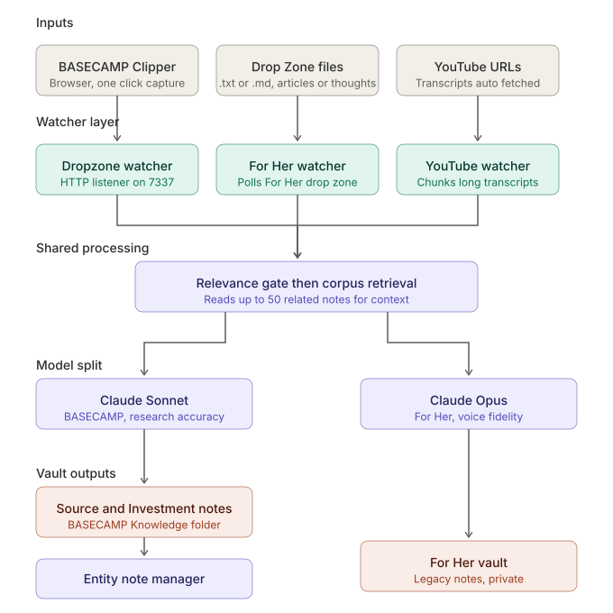

# Second-Brain

A personal research system built on Obsidian and the Claude API. Drop a document into a folder, clip a web page, or paste a YouTube link, and it comes back as a structured, linked research note.

## Why I built it

I spent 20 years reading filings, transcripts and analyst research and keeping the conclusions in my head or in scattered files. I wanted the reading to compound: every source tied to the companies it mentions, and every company note updated as new sources arrive.

## What it does

- **Watches a drop folder.** A Python watcher, run as a macOS LaunchAgent, picks up new files and URLs.
- **Turns each source into two notes.** A Source Note (what the document says) and an Investment Note (what it means), both in a fixed schema.
- **Maintains company notes.** Any ticker in a source updates that company's Entity Note, with backlinks to every source that mentioned it.
- **Takes input from the browser.** A small Chrome extension sends the current page to a local endpoint on the watcher.
- **Pulls context forward.** Before writing a note, the watcher gives Claude the relevant existing notes, so new notes build on old ones.

Current scale: about 40 company notes and 40 source notes.

## How it fits together

See [ARCHITECTURE.md](ARCHITECTURE.md) and the diagram below.

## Stack

Python 3, Anthropic Python SDK, PyYAML, Obsidian (Markdown vault), macOS launchd, Chrome extension (JavaScript).

## Running it

1. `pip install anthropic pyyaml`
2. Set `ANTHROPIC_API_KEY`, `VAULT_ROOT` and `ENTITY_MANAGER` as environment variables.
3. `python dropzone_watcher.py`

No vault content is in this repo. The `.gitignore` excludes `.obsidian/`, `.env` and key files.

## Status

In daily use. Next: a daily brief generator.
